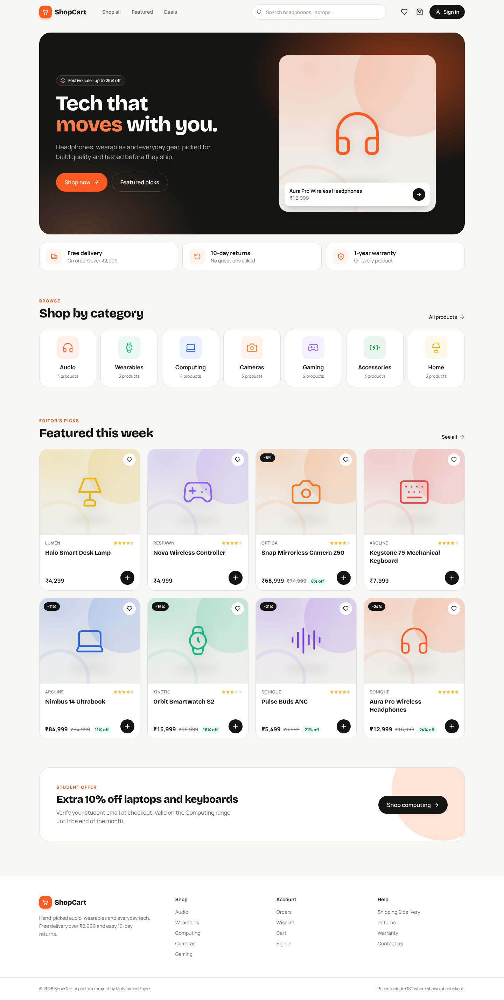
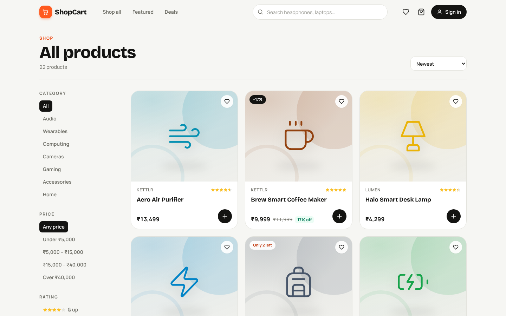
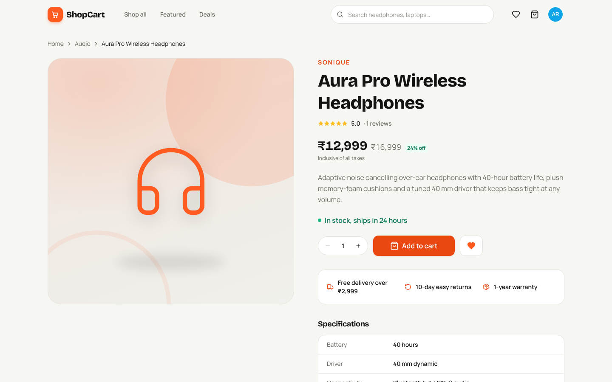
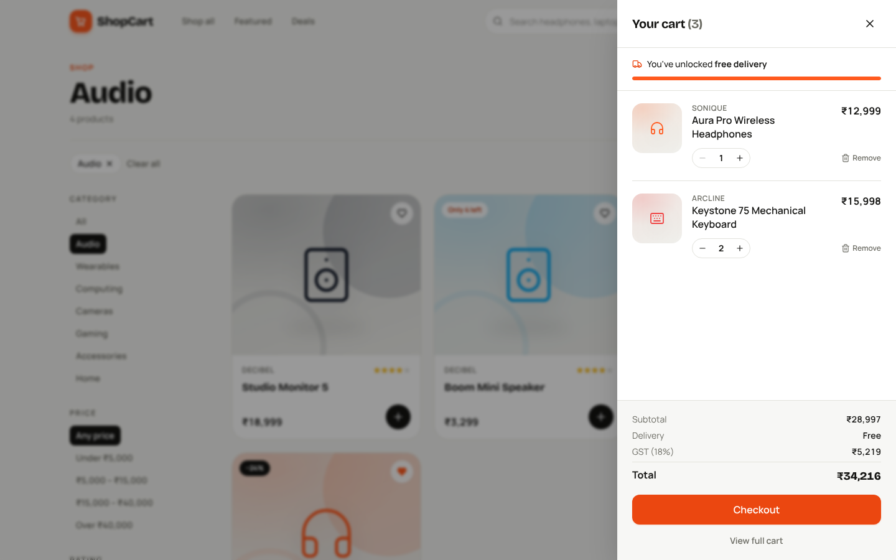
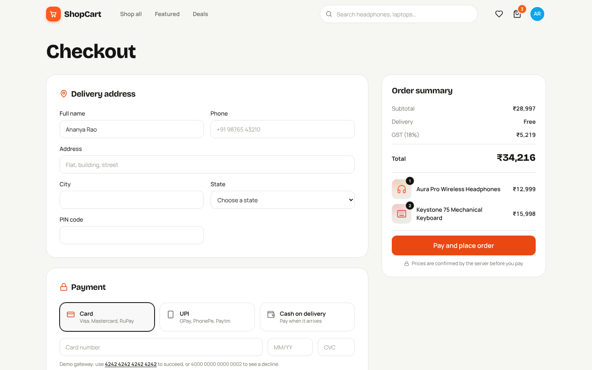
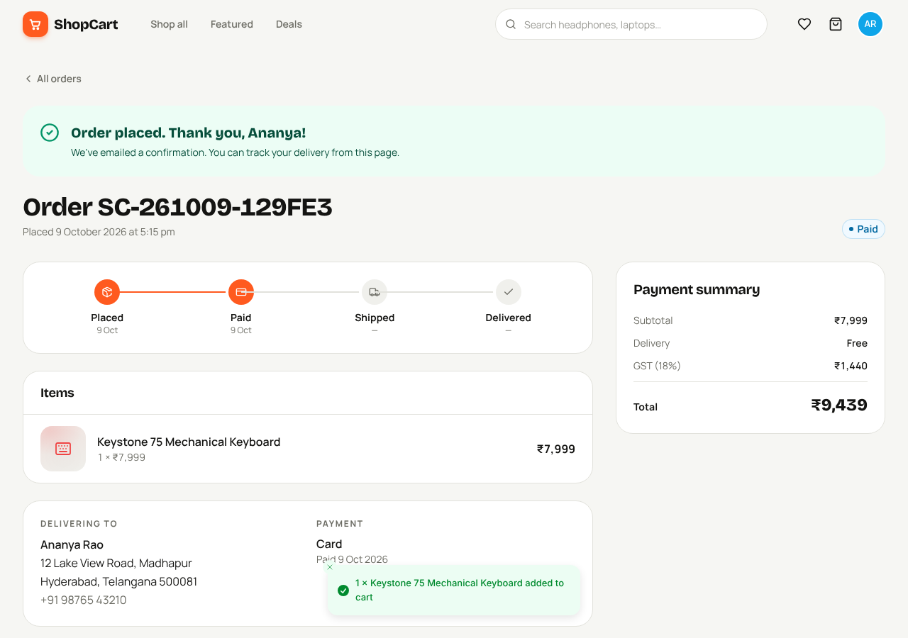
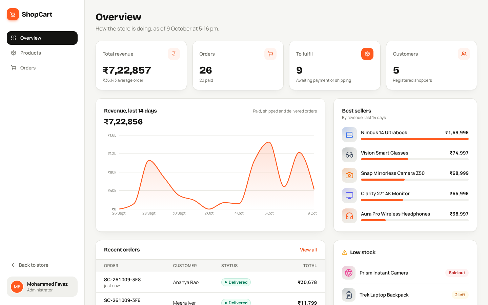
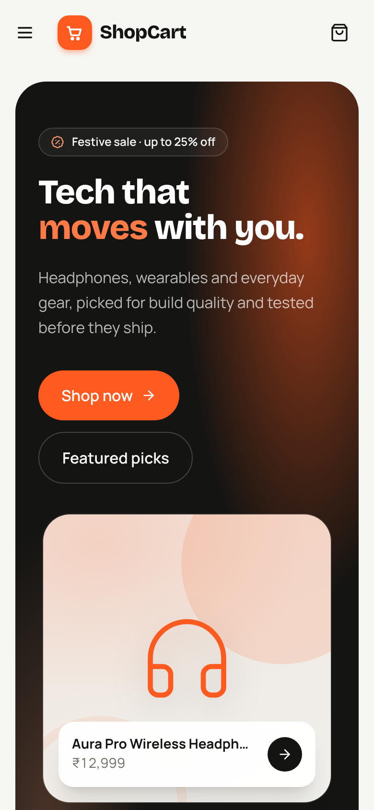
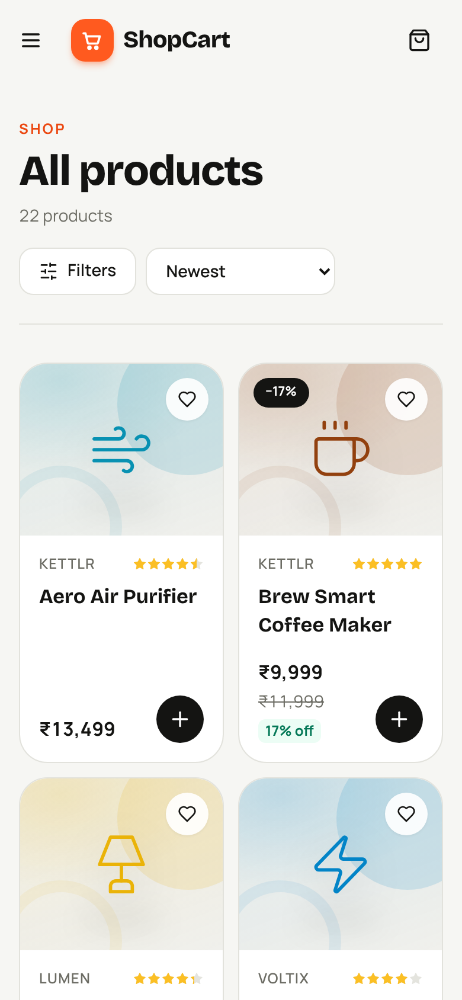

<div align="center">

# 🛒 ShopCart

**A full-stack MERN e-commerce platform** — product catalog, cart, checkout with a payment step, order tracking and an admin dashboard.

### [▶ Open the live demo](https://mdfayaz25.github.io/shopcart/)




</div>

## Live demo

**[https://mdfayaz25.github.io/shopcart/](https://mdfayaz25.github.io/shopcart/)**

The live demo is a static build of the same React app hosted on GitHub Pages. Because Pages can't run Node or MongoDB, the demo build swaps the HTTP and WebSocket layer for an in-browser backend (`client/src/demo/`) that implements the same REST routes and realtime events over sample data exported from the seed script. Everything you do is saved in your browser's localStorage; **Reset demo** in the top bar restores the sample data.

Sign in with Shopper `demo@shopcart.dev` / `Demo@1234` · Admin `admin@shopcart.dev` / `Admin@123` (one-click buttons on the sign-in page). Pay with test card `4242 4242 4242 4242`.

Build it yourself with `npm run build:pages` (output in `client/dist`). The `Deploy live demo` workflow publishes it to the `gh-pages` branch on every push to `main`.

## Features

**Storefront**
- Catalog with search, category, price and rating filters, sorting and pagination — all kept in the URL so results are shareable
- Product pages with specs, stock status, star ratings and verified-purchase reviews
- Slide-over cart (Redux Toolkit, persisted to `localStorage`) with a free-delivery progress bar
- Wishlist synced to your account
- Fully responsive, from a 360 px phone to a wide desktop

**Checkout & orders**
- Address form validated with Zod + React Hook Form
- Card, UPI or cash on delivery. Card and UPI go through a mock gateway (`4242 4242 4242 4242` succeeds, `4000 0000 0000 0002` is declined) that can be swapped for Stripe or Razorpay
- **Prices are calculated on the server** — the client never sends totals
- Stock is reserved atomically when an order is placed and released if it is cancelled
- Order page with a delivery timeline, retry-payment and cancel actions

**Admin dashboard**
- Revenue chart for the last 14 days, best sellers, low-stock alerts and recent orders
- Product management (create, edit, delete) with a live preview
- Order management with guarded status transitions (pending → paid → shipped → delivered)

**Engineering**
- TypeScript end to end, strict mode on both sides
- JWT auth with role-based access (`user` / `admin`) and bcrypt-hashed passwords
- Request validation with Zod, consistent JSON errors, Helmet security headers
- Integration tests with Vitest + Supertest against a real MongoDB
- GitHub Actions CI: typecheck, test and build on every push

## Screenshots

| Shop | Product |
| --- | --- |
|  |  |
| **Cart** | **Checkout** |
|  |  |
| **Order placed** | **Admin dashboard** |
|  |  |

<p align="center"> </p>

## Tech stack

| Layer | Tools |
| --- | --- |
| Frontend | React 18, TypeScript, Vite, Redux Toolkit, TanStack Query, React Router, Tailwind CSS, Framer Motion, Recharts |
| Backend | Node.js, Express, Mongoose, Zod, JSON Web Tokens, bcrypt, Helmet |
| Database | MongoDB |
| Testing & CI | Vitest, Supertest, GitHub Actions |

## Getting started

**Requirements:** Node.js 20+ and MongoDB (local, Docker or Atlas).

```bash
git clone https://github.com/mdfayaz25/shopcart.git
cd shopcart
npm install

# MongoDB via Docker (or set MONGO_URI to your Atlas cluster)
docker compose up -d

cp server/.env.example server/.env
npm run seed      # 22 products, demo users and 2 weeks of orders
npm run dev       # API on :5000, web app on :5173
```

Open http://localhost:5173 and sign in with a demo account:

| Role | Email | Password |
| --- | --- | --- |
| Shopper | `demo@shopcart.dev` | `Demo@1234` |
| Admin | `admin@shopcart.dev` | `Admin@123` |

### Scripts

| Command | What it does |
| --- | --- |
| `npm run dev` | Runs the API and the React app together |
| `npm run seed` | Resets the database with sample data |
| `npm test` | Runs the API integration tests |
| `npm run typecheck` | Type-checks server and client |
| `npm run build` then `npm start` | Production build; Express serves the React app |

## API overview

| Method | Endpoint | Access |
| --- | --- | --- |
| `POST` | `/api/auth/register`, `/api/auth/login` | Public |
| `GET` | `/api/products?search&category&minPrice&maxPrice&rating&sort&page` | Public |
| `GET` | `/api/products/:slug` | Public |
| `POST` | `/api/products/:id/reviews` | Customers who bought it |
| `POST` `PATCH` `DELETE` | `/api/products/:id` | Admin |
| `POST` | `/api/orders` | Signed in |
| `POST` | `/api/orders/:id/pay`, `/api/orders/:id/cancel` | Order owner |
| `GET` | `/api/orders/mine`, `/api/orders/:id` | Signed in |
| `GET` `PATCH` | `/api/orders`, `/api/orders/:id/status` | Admin |
| `GET` `POST` | `/api/wishlist`, `/api/wishlist/:productId` | Signed in |
| `GET` | `/api/admin/stats` | Admin |

## Project structure

```
shopcart/
├── client/                 React app (Vite)
│   └── src/
│       ├── components/     UI kit, layout, product and order components
│       ├── pages/          Storefront, account and admin pages
│       ├── store/          Redux Toolkit cart slice
│       └── lib/            API client, formatting helpers
├── server/                 Express API
│   ├── src/
│   │   ├── models/         Mongoose schemas
│   │   ├── routes/         Route handlers
│   │   ├── middleware/     Auth, validation, errors
│   │   └── seed.ts         Sample data
│   └── tests/              Vitest + Supertest
└── .github/workflows/      CI
```

## A note on product images

Products use illustrated tiles built from an icon and a brand colour, so the demo never shows a broken image and needs no image hosting. Admins can set an image URL on any product and it will be used instead.

## License

MIT © [Mohammed Fayaz](https://github.com/mdfayaz25)
